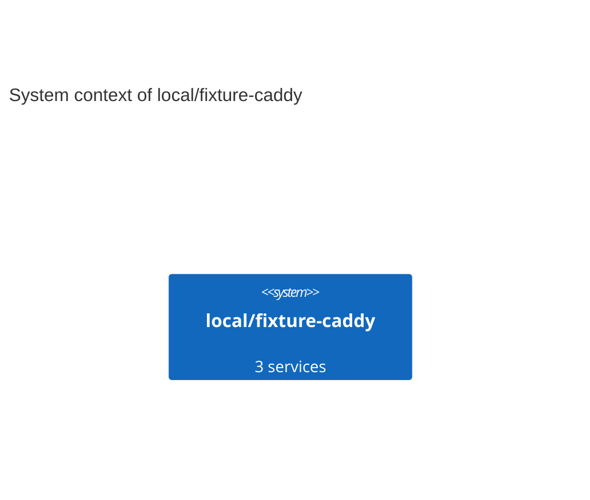
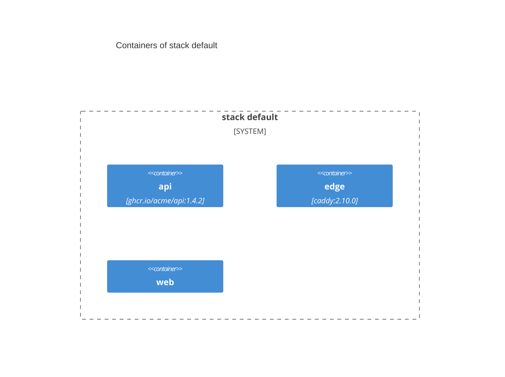

# Architecture of local/fixture-caddy

Generated by cernly test from commit `0123456` of 2026-10-14T16:02:11Z; rules 0.17.2, catalogue 2026.11.2, default branch `main`. Everything below is read from the repository's tracked files, without building or running it. Each statement has a footnote with the facts behind it and the file and line of each. Sections the code cannot answer are left for a person to write.

**Surface in all stacks:** 0 outside parties, 0 data stores, 0 columns to check, 2 unpinned images, 0 production stacks, 9 routes. Size, for context: 3 lines in 1 file (typescript 3).

## 1. Introduction and goals

_Not in the code: What the system is for, and its most important quality goals._

## 2. Constraints

_Not in the code: Technical and organisational constraints._

## 3. Context and scope

No outside party is named in the code, configuration or images.

Ways in, through the web servers:

| Site | Match | Action | To | Evidence |
|---|---|---|---|---|
| blog.acme-widgets.be | * | file_server |  | [^1] |
| shop.acme-widgets.be, www.acme-widgets.be | * | proxy | web2:3000 | [^2] |
| shop.acme-widgets.be, www.acme-widgets.be | * | proxy | web (stack default) | [^3] |
| shop.acme-widgets.be, www.acme-widgets.be | /api/* | proxy | api (stack default) | [^4] |
| shop.acme-widgets.be, www.acme-widgets.be | /old/* | redirect |  | [^5] |
| shop.acme-widgets.be, www.acme-widgets.be | @internal | respond |  | [^6] |
| shop.acme-widgets.be, www.acme-widgets.be | POST /hooks/* | proxy | api (stack default) | [^7] |
| {$OPS_HOST:ops.localhost} | * | proxy | host.docker.internal:3010 | [^8] |
| {$OPS_HOST:ops.localhost} | /health | respond |  | [^9] |

## 4. Solution strategy

_Not in the code: The fundamental decisions that shape the architecture._

## 5. Building block view

### Stack default (none)

| Container | Kind | Code | Size | Evidence |
|---|---|---|---|---|
| api | service | third-party image api |  | [^10] |
| edge | service | third-party image caddy |  | [^11] |
| web | service |  |  | [^12] |

## 6. Runtime view

_Not in the code: How the building blocks work together in the most important scenarios._

## 7. Deployment view

Production is a stack a CI job on the default branch (`main`) starts, or one a person declared or confirmed.

| Stack | Role | Why | Evidence |
|---|---|---|---|
| default | none | no CI job starts it | [^13] |

## 8. Crosscutting concepts

### Data

No data store runs in a stack of the repository.

## 9. Architecture decisions

_Not in the code: Decisions and why they were taken._

## 10. Quality requirements

_Not in the code: Quality scenarios._

## 11. Risks and technical debt

### image_pinning (2)

- api (stack default): image ghcr.io/acme/api:1.4.2 is not pinned by digest [^10]
- edge (stack default): image caddy:2.10.0 is not pinned by digest [^11]

### no_code_link (1)

- web (stack default): build: names web/Dockerfile (final stage), no such recipe [^12]

## 12. Glossary

_Not in the code._

## Evidence

[^1]: `route:caddy:deploy/Caddyfile:blog.acme-widgets.be:*`: `deploy/sites/blog.caddy:1`, `deploy/sites/blog.caddy:4`; `service:compose:default:edge`: `docker-compose.yml:6`
[^2]: `route:caddy:deploy/Caddyfile:shop.acme-widgets.be:*`: `deploy/Caddyfile:13`, `deploy/Caddyfile:28`; `service:compose:default:edge`: `docker-compose.yml:6`
[^3]: `route:caddy:deploy/Caddyfile:shop.acme-widgets.be:*`: `deploy/Caddyfile:13`, `deploy/Caddyfile:28`; `service:compose:default:edge`: `docker-compose.yml:6`; `service:compose:default:web`: `docker-compose.yml:2`
[^4]: `route:caddy:deploy/Caddyfile:shop.acme-widgets.be:/api/*`: `deploy/Caddyfile:9`, `deploy/Caddyfile:13`, `deploy/Caddyfile:14`; `service:compose:default:api`: `docker-compose.yml:4`; `service:compose:default:edge`: `docker-compose.yml:6`
[^5]: `route:caddy:deploy/Caddyfile:shop.acme-widgets.be:/old/*`: `deploy/Caddyfile:13`, `deploy/Caddyfile:25`; `service:compose:default:edge`: `docker-compose.yml:6`
[^6]: `route:caddy:deploy/Caddyfile:shop.acme-widgets.be:@internal`: `deploy/Caddyfile:13`, `deploy/Caddyfile:23`; `service:compose:default:edge`: `docker-compose.yml:6`
[^7]: `route:caddy:deploy/Caddyfile:shop.acme-widgets.be:POST /hooks/*`: `deploy/Caddyfile:13`, `deploy/Caddyfile:20`; `service:compose:default:api`: `docker-compose.yml:4`; `service:compose:default:edge`: `docker-compose.yml:6`
[^8]: `route:caddy:deploy/Caddyfile:{$OPS_HOST:ops.localhost}:*`: `deploy/Caddyfile:34`, `deploy/Caddyfile:35`; `service:compose:default:edge`: `docker-compose.yml:6`
[^9]: `route:caddy:deploy/Caddyfile:{$OPS_HOST:ops.localhost}:/health`: `deploy/Caddyfile:34`, `deploy/Caddyfile:36`; `service:compose:default:edge`: `docker-compose.yml:6`
[^10]: `service:compose:default:api`: `docker-compose.yml:4`
[^11]: `service:compose:default:edge`: `docker-compose.yml:6`
[^12]: `service:compose:default:web`: `docker-compose.yml:2`
[^13]: `stack:compose:default`: `docker-compose.yml:1`
