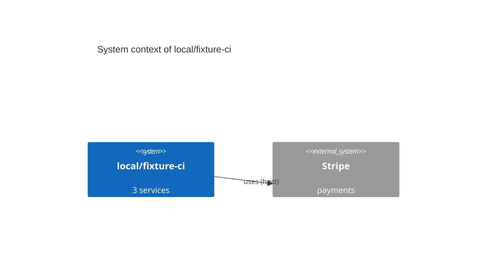
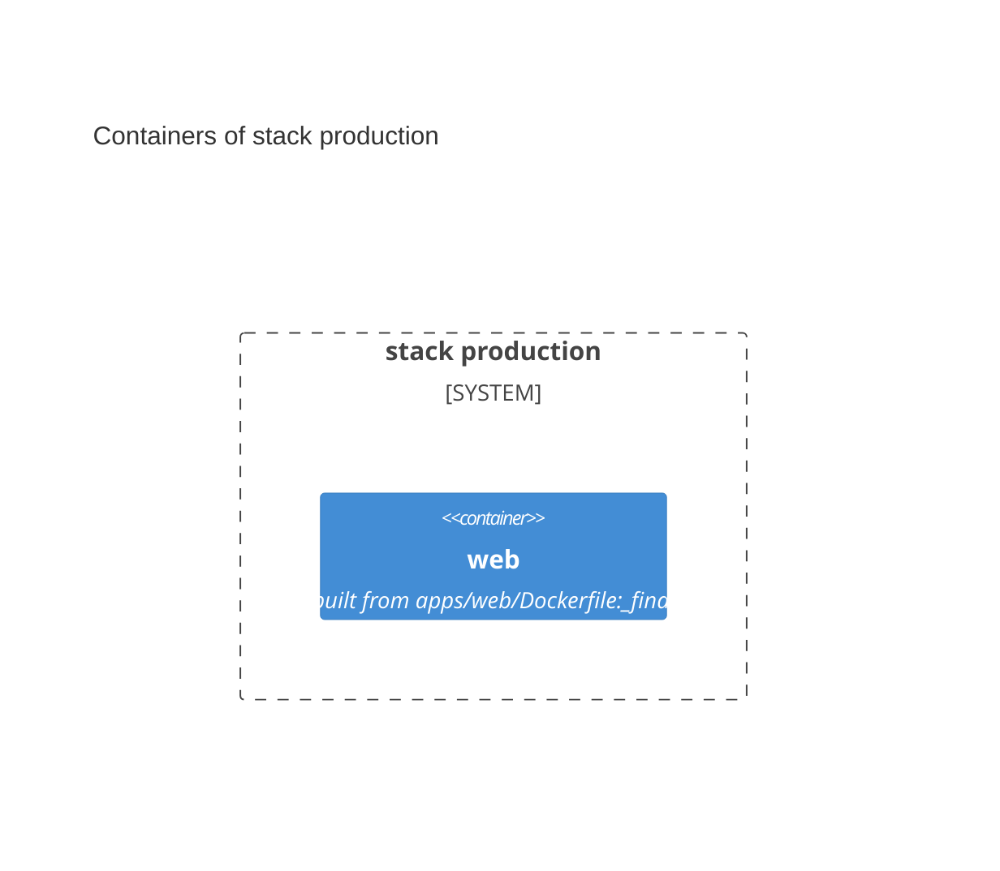
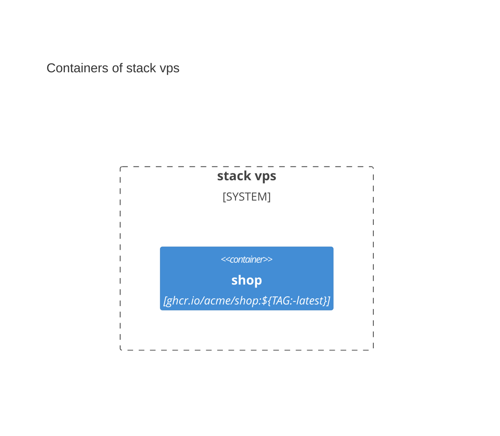

# Architecture of local/fixture-ci

Generated by cernly test from commit `0123456` of 2026-10-14T16:02:11Z; rules 0.17.2, catalogue 2026.11.2, default branch `main`. Everything below is read from the repository's tracked files, without building or running it. Each statement has a footnote with the facts behind it and the file and line of each. Sections the code cannot answer are left for a person to write.

**Surface in production:** 0 outside parties, 0 data stores, 0 columns to check, 3 unpinned images, 2 production stacks, 0 routes.

## 1. Introduction and goals

_Not in the code: What the system is for, and its most important quality goals._

## 2. Constraints

_Not in the code: Technical and organisational constraints._

## 3. Context and scope

Outside parties, as the provider catalogue (2026.11.2) recognises them:

| Party | Category | Seen by | Services | Evidence |
|---|---|---|---|---|
| Stripe | payments | host | apps/api/Dockerfile _final (built in CI) | [^1] |

## 4. Solution strategy

_Not in the code: The fundamental decisions that shape the architecture._

## 5. Building block view

### Stack production (production)

| Container | Kind | Code | Size | Evidence |
|---|---|---|---|---|
| web | service | apps/web |  | [^2] |

### Stack vps (production)

| Container | Kind | Code | Size | Evidence |
|---|---|---|---|---|
| shop | service | third-party image shop |  | [^3] |

### Images built in CI that no stack runs

| Image | Dockerfile | Pushed to | Evidence |
|---|---|---|---|
| api | apps/api/Dockerfile _final | ghcr.io/acme/api | [^4] |
| acme-e2e | tests/e2e/Dockerfile _final | no push seen | [^5] |

## 6. Runtime view

_Not in the code: How the building blocks work together in the most important scenarios._

## 7. Deployment view

Production is a stack a CI job on the default branch (`main`) starts, or one a person declared or confirmed.

| Stack | Role | Why | Evidence |
|---|---|---|---|
| ci | none | .github/workflows/verify.yml job verify: not production: job verify only runs tests after starting the stack (go test ./... at .github/workflows/verify.yml:12) | [^6] |
| e2e | none | .github/workflows/e2e-tests.yml job e2e_tests: not production: started by test job e2e_tests (.github/workflows/e2e-tests.yml:9) | [^7] |
| production | production | .github/workflows/deploy.yml job deploy: push on main | [^8] |
| vps | production | .github/workflows/ship.yml job test-and-deploy: push on main | [^9] |

## 8. Crosscutting concepts

### Data

| Data store | Engine | Stack | Evidence |
|---|---|---|---|
| cache | redis 7 | ci | [^10] |
| db | postgres 17 | e2e | [^11] |

## 9. Architecture decisions

_Not in the code: Decisions and why they were taken._

## 10. Quality requirements

_Not in the code: Quality scenarios._

## 11. Risks and technical debt

### driver_without_store (1)

- dependency:npm:apps/api:mysql2: ci_image:apps/api/Dockerfile:_final ships mysql2, a mysql driver, but no mysql data store is described [^12]

### image_pinning (9)

- cache (stack ci): image redis:7 is not pinned by digest [^10]
- db (stack e2e): image postgres:17 is not pinned by digest [^11]
- apps/api/Dockerfile, final stage: stage _final uses node:22-alpine is not pinned by digest [^13]
- apps/api/Dockerfile, stage build: stage build uses node:22-alpine is not pinned by digest [^14]
- apps/web/Dockerfile, final stage: stage _final uses nginx:1.27-alpine is not pinned by digest [^15]
- tests/e2e/Dockerfile, final stage: stage _final uses mcr.microsoft.com/playwright:v1.48.0-jammy is not pinned by digest [^16]
- mail (stack e2e): image axllent/mailpit:v1.20 is not pinned by digest [^17]
- web (stack production): image ghcr.io/acme/web:${TAG:-latest} is not pinned by digest [^18]
- shop (stack vps): image ghcr.io/acme/shop:${TAG:-latest} is not pinned by digest [^3]

### party_unconfirmed (1)

- party:stripe: Stripe rests on one kind of signal (host); confirm once [^1]

## 12. Glossary

_Not in the code._

## Evidence

[^1]: `outbound_host:api.stripe.com`: `apps/api/src/server.js:5`
[^2]: `image_build:web:apps/web/Dockerfile:_`: `.github/workflows/publish.yml:20`; `image_recipe:apps/web/Dockerfile:_final`: `apps/web/Dockerfile:1`, `apps/web/Dockerfile:2`; `service:compose:production:web`: `.github/workflows/deploy.yml:13`, `docker-compose.prod.yml:2`
[^3]: `service:compose:vps:shop`: `.github/workflows/ship.yml:14`, `docker-compose.vps.yml:2`
[^4]: `image_build:api:apps/api/Dockerfile:_`: `.github/workflows/publish.yml:12`; `image_recipe:apps/api/Dockerfile:_final`: `apps/api/Dockerfile:1`, `apps/api/Dockerfile:3`, `apps/api/Dockerfile:4`, `apps/api/Dockerfile:7`, `apps/api/Dockerfile:9`
[^5]: `image_build:acme-e2e:tests/e2e/Dockerfile:_`: `.github/workflows/publish.yml:31`; `image_recipe:tests/e2e/Dockerfile:_final`: `tests/e2e/Dockerfile:1`, `tests/e2e/Dockerfile:3`
[^6]: `stack:compose:ci`: `.github/workflows/verify.yml:11`, `.github/workflows/verify.yml:17`
[^7]: `stack:compose:e2e`: `.github/workflows/e2e-tests.yml:16`, `package.json:5`
[^8]: `stack:compose:production`: `.github/workflows/deploy.yml:13`
[^9]: `stack:compose:vps`: `.github/workflows/ship.yml:14`
[^10]: `datastore:compose:ci:cache`: `.github/workflows/verify.yml:11`, `.github/workflows/verify.yml:17`, `docker-compose.ci.yml:2`
[^11]: `datastore:compose:e2e:db`: `.github/workflows/e2e-tests.yml:16`, `docker-compose.e2e.yml:2`, `package.json:5`
[^12]: `dependency:npm:apps/api:mysql2`: `apps/api/package.json:6`
[^13]: `image_recipe:apps/api/Dockerfile:_final`: `apps/api/Dockerfile:1`, `apps/api/Dockerfile:3`, `apps/api/Dockerfile:4`, `apps/api/Dockerfile:7`, `apps/api/Dockerfile:9`
[^14]: `image_recipe:apps/api/Dockerfile:build`: `apps/api/Dockerfile:1`, `apps/api/Dockerfile:3`, `apps/api/Dockerfile:4`
[^15]: `image_recipe:apps/web/Dockerfile:_final`: `apps/web/Dockerfile:1`, `apps/web/Dockerfile:2`
[^16]: `image_recipe:tests/e2e/Dockerfile:_final`: `tests/e2e/Dockerfile:1`, `tests/e2e/Dockerfile:3`
[^17]: `service:compose:e2e:mail`: `.github/workflows/e2e-tests.yml:16`, `docker-compose.e2e.yml:4`, `package.json:5`
[^18]: `service:compose:production:web`: `.github/workflows/deploy.yml:13`, `docker-compose.prod.yml:2`
