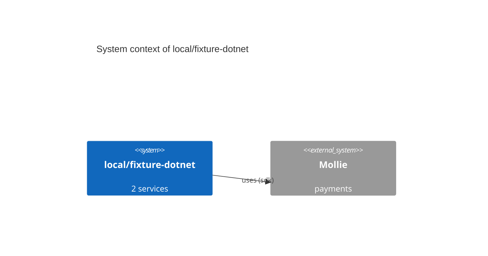
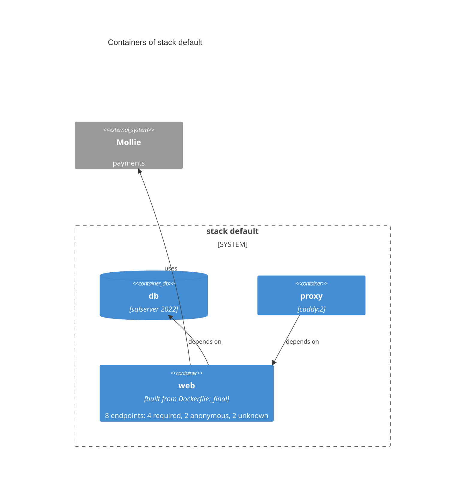
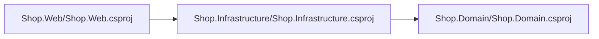

# Architecture of local/fixture-dotnet

Generated by cernly test from commit `0123456` of 2026-10-14T16:02:11Z; rules 0.17.2, catalogue 2026.11.2, default branch `main`. Everything below is read from the repository's tracked files, without building or running it. Each statement has a footnote with the facts behind it and the file and line of each. Sections the code cannot answer are left for a person to write.

**Surface in production:** 1 outside party, 1 data store, 1 column to check, 3 unpinned images, 1 production stack, 2 routes. Size, for context: 239 lines in 10 files (csharp 239).

## 1. Introduction and goals

_Not in the code: What the system is for, and its most important quality goals._

## 2. Constraints

_Not in the code: Technical and organisational constraints._

## 3. Context and scope

Outside parties, as the provider catalogue (2026.11.2) recognises them:

| Party | Category | Seen by | Services | Evidence |
|---|---|---|---|---|
| Mollie | payments | sdk | web (stack default) | [^1] |

Hosts the code points at that no catalogue entry names (2): `api.parcelvendor.io` [^2], `api.ratesvendor.io` [^3].

Ways in, through the web servers:

| Site | Match | Action | To | Evidence |
|---|---|---|---|---|
| shop.shopfront.io | * | proxy | web (stack default) | [^4] |
| shop.shopfront.io | /static/* | file_server |  | [^5] |

## 4. Solution strategy

_Not in the code: The fundamental decisions that shape the architecture._

## 5. Building block view

### Stack default (production)

| Container | Kind | Code | Size | Evidence |
|---|---|---|---|---|
| db | data store, sqlserver |  |  | [^6] |
| proxy | service | third-party image caddy |  | [^7] |
| web | service | . (narrowed to src/Shop.Web; excluded legacy/Old.Web, tests/Shop.Tests) | 239 lines (csharp 239) | [^8] |

Endpoints of web:

| Method | Path | Auth | Routes | Evidence |
|---|---|---|---|---|
| GET | / | unknown | shop.shopfront.io * (public) | [^9] |
| GET | /api/Catalog | anonymous (\[AllowAnonymous\]) | shop.shopfront.io * (public) | [^10] |
| GET | /api/Catalog/{id} | required (\[Authorize\]) | shop.shopfront.io * (public) | [^11] |
| GET | /api/orders | required (RequireAuthorization()) | shop.shopfront.io * (public) | [^12] |
| GET | /api/orders/{id} | required (RequireAuthorization()) | shop.shopfront.io * (public) | [^13] |
| GET | /counter | unknown | shop.shopfront.io * (public) | [^14] |
| GET | /health | anonymous (AllowAnonymous()) | shop.shopfront.io * (public) | [^15] |
| POST | /import | required (\[Authorize\]) | shop.shopfront.io * (public) | [^16] |

### Module graphs

The repo's own packages each service reaches, and the imports between them. Read from the import declarations; Go only for now.

**web (stack default)**: 3 packages, 2 imports; every package in its sources [^17]

| Package | Imported by | Imports | Depth |
|---|---|---|---|
| `src/Shop.Domain/Shop.Domain.csproj` | 2 | 0 | 0 |
| `src/Shop.Infrastructure/Shop.Infrastructure.csproj` | 1 | 1 | 1 |
| `src/Shop.Web/Shop.Web.csproj` | 0 | 1 | 2 |

## 6. Runtime view

_Not in the code: How the building blocks work together in the most important scenarios._

## 7. Deployment view

Production is a stack a CI job on the default branch (`main`) starts, or one a person declared or confirmed.

| Stack | Role | Why | Evidence |
|---|---|---|---|
| default | production | .github/workflows/deploy.yml job deploy: push on main | [^18] |

## 8. Crosscutting concepts

### Data

| Data store | Engine | Stack | Evidence |
|---|---|---|---|
| db | sqlserver 2022 | default | [^6] |

2 tables in the schema sources, 1 column whose names look sensitive.

| Table | Columns to check | Evidence |
|---|---|---|
| dbo.Customers | Email | [^19] |

## 9. Architecture decisions

_Not in the code: Decisions and why they were taken._

## 10. Quality requirements

_Not in the code: Quality scenarios._

## 11. Risks and technical debt

### endpoint_anonymous_public (2)

- endpoint:csharp:src/Shop.Web/Controllers/CatalogController.cs:GET:/api/Catalog: route:caddy:Caddyfile:shop.shopfront.io:* (\[AllowAnonymous\]) [^20]
- endpoint:csharp:src/Shop.Web/Program.cs:GET:/health: route:caddy:Caddyfile:shop.shopfront.io:* (AllowAnonymous()) [^21]

### image_pinning (4)

- db (stack default): image mcr.microsoft.com/mssql/server:2022-latest is not pinned by digest [^6]
- Dockerfile, final stage: stage _final uses mcr.microsoft.com/dotnet/aspnet:9.0 is not pinned by digest [^22]
- Dockerfile, stage build: stage build uses mcr.microsoft.com/dotnet/sdk:9.0 is not pinned by digest [^23]
- proxy (stack default): image caddy:2 is not pinned by digest [^7]

### party_unconfirmed (1)

- party:mollie: Mollie rests on one kind of signal (sdk); confirm once [^1]

## 12. Glossary

_Not in the code._

## Evidence

[^1]: `dependency:nuget:src/Shop.Web/Shop.Web.csproj:mollie.api`: `Directory.Packages.props:9`, `src/Shop.Web/Shop.Web.csproj:7`
[^2]: `outbound_host:api.parcelvendor.io`: `src/Shop.Web/appsettings.json:5`
[^3]: `outbound_host:api.ratesvendor.io`: `src/Shop.Web/Program.cs:9`
[^4]: `route:caddy:Caddyfile:shop.shopfront.io:*`: `Caddyfile:1`, `Caddyfile:5`; `service:compose:default:proxy`: `.github/workflows/deploy.yml:11`, `docker-compose.yml:14`; `service:compose:default:web`: `.github/workflows/deploy.yml:11`, `docker-compose.yml:2`
[^5]: `route:caddy:Caddyfile:shop.shopfront.io:/static/*`: `Caddyfile:1`, `Caddyfile:3`; `service:compose:default:proxy`: `.github/workflows/deploy.yml:11`, `docker-compose.yml:14`
[^6]: `datastore:compose:default:db`: `.github/workflows/deploy.yml:11`, `docker-compose.yml:10`
[^7]: `service:compose:default:proxy`: `.github/workflows/deploy.yml:11`, `docker-compose.yml:14`
[^8]: `image_recipe:Dockerfile:_final`: `Dockerfile:1`, `Dockerfile:3`, `Dockerfile:4`, `Dockerfile:6`, `Dockerfile:8`; `service:compose:default:web`: `.github/workflows/deploy.yml:11`, `docker-compose.yml:2`
[^9]: `endpoint:csharp:src/Shop.Web/Pages/Index.cshtml:GET:/`: `src/Shop.Web/Pages/Index.cshtml:1`; `image_recipe:Dockerfile:_final`: `Dockerfile:1`, `Dockerfile:3`, `Dockerfile:4`, `Dockerfile:6`, `Dockerfile:8`; `service:compose:default:web`: `.github/workflows/deploy.yml:11`, `docker-compose.yml:2`
[^10]: `endpoint:csharp:src/Shop.Web/Controllers/CatalogController.cs:GET:/api/Catalog`: `src/Shop.Web/Controllers/CatalogController.cs:7`, `src/Shop.Web/Controllers/CatalogController.cs:11`, `src/Shop.Web/Controllers/CatalogController.cs:12`; `image_recipe:Dockerfile:_final`: `Dockerfile:1`, `Dockerfile:3`, `Dockerfile:4`, `Dockerfile:6`, `Dockerfile:8`; `service:compose:default:web`: `.github/workflows/deploy.yml:11`, `docker-compose.yml:2`
[^11]: `endpoint:csharp:src/Shop.Web/Controllers/CatalogController.cs:GET:/api/Catalog/{id}`: `src/Shop.Web/Controllers/CatalogController.cs:7`, `src/Shop.Web/Controllers/CatalogController.cs:8`, `src/Shop.Web/Controllers/CatalogController.cs:15`; `image_recipe:Dockerfile:_final`: `Dockerfile:1`, `Dockerfile:3`, `Dockerfile:4`, `Dockerfile:6`, `Dockerfile:8`; `service:compose:default:web`: `.github/workflows/deploy.yml:11`, `docker-compose.yml:2`
[^12]: `endpoint:csharp:src/Shop.Web/Program.cs:GET:/api/orders`: `src/Shop.Web/Program.cs:16`, `src/Shop.Web/Program.cs:17`; `image_recipe:Dockerfile:_final`: `Dockerfile:1`, `Dockerfile:3`, `Dockerfile:4`, `Dockerfile:6`, `Dockerfile:8`; `service:compose:default:web`: `.github/workflows/deploy.yml:11`, `docker-compose.yml:2`
[^13]: `endpoint:csharp:src/Shop.Web/Program.cs:GET:/api/orders/{id}`: `src/Shop.Web/Program.cs:16`, `src/Shop.Web/Program.cs:18`; `image_recipe:Dockerfile:_final`: `Dockerfile:1`, `Dockerfile:3`, `Dockerfile:4`, `Dockerfile:6`, `Dockerfile:8`; `service:compose:default:web`: `.github/workflows/deploy.yml:11`, `docker-compose.yml:2`
[^14]: `endpoint:csharp:src/Shop.Web/Pages/Counter.razor:GET:/counter`: `src/Shop.Web/Pages/Counter.razor:1`; `image_recipe:Dockerfile:_final`: `Dockerfile:1`, `Dockerfile:3`, `Dockerfile:4`, `Dockerfile:6`, `Dockerfile:8`; `service:compose:default:web`: `.github/workflows/deploy.yml:11`, `docker-compose.yml:2`
[^15]: `endpoint:csharp:src/Shop.Web/Program.cs:GET:/health`: `src/Shop.Web/Program.cs:14`; `image_recipe:Dockerfile:_final`: `Dockerfile:1`, `Dockerfile:3`, `Dockerfile:4`, `Dockerfile:6`, `Dockerfile:8`; `service:compose:default:web`: `.github/workflows/deploy.yml:11`, `docker-compose.yml:2`
[^16]: `endpoint:csharp:src/Shop.Web/Controllers/CatalogController.cs:POST:/import`: `src/Shop.Web/Controllers/CatalogController.cs:8`, `src/Shop.Web/Controllers/CatalogController.cs:18`; `image_recipe:Dockerfile:_final`: `Dockerfile:1`, `Dockerfile:3`, `Dockerfile:4`, `Dockerfile:6`, `Dockerfile:8`; `service:compose:default:web`: `.github/workflows/deploy.yml:11`, `docker-compose.yml:2`
[^17]: `import:dotnet:src/Shop.Infrastructure/Shop.Infrastructure.csproj:src/Shop.Domain/Shop.Domain.csproj`: `src/Shop.Infrastructure/Shop.Infrastructure.csproj:10`; `import:dotnet:src/Shop.Web/Shop.Web.csproj:src/Shop.Infrastructure/Shop.Infrastructure.csproj`: `src/Shop.Web/Shop.Web.csproj:11`
[^18]: `stack:compose:default`: `.github/workflows/deploy.yml:11`
[^19]: `db_column:efcore:src/Shop.Infrastructure/Migrations:ShopDbContext:dbo.Customers.Email`: `src/Shop.Infrastructure/Migrations/20250301090000_AddCustomers.cs:19`
[^20]: `endpoint:csharp:src/Shop.Web/Controllers/CatalogController.cs:GET:/api/Catalog`: `src/Shop.Web/Controllers/CatalogController.cs:7`, `src/Shop.Web/Controllers/CatalogController.cs:11`, `src/Shop.Web/Controllers/CatalogController.cs:12`; `route:caddy:Caddyfile:shop.shopfront.io:*`: `Caddyfile:1`, `Caddyfile:5`; `service:compose:default:web`: `.github/workflows/deploy.yml:11`, `docker-compose.yml:2`
[^21]: `endpoint:csharp:src/Shop.Web/Program.cs:GET:/health`: `src/Shop.Web/Program.cs:14`; `route:caddy:Caddyfile:shop.shopfront.io:*`: `Caddyfile:1`, `Caddyfile:5`; `service:compose:default:web`: `.github/workflows/deploy.yml:11`, `docker-compose.yml:2`
[^22]: `image_recipe:Dockerfile:_final`: `Dockerfile:1`, `Dockerfile:3`, `Dockerfile:4`, `Dockerfile:6`, `Dockerfile:8`
[^23]: `image_recipe:Dockerfile:build`: `Dockerfile:1`, `Dockerfile:3`, `Dockerfile:4`
