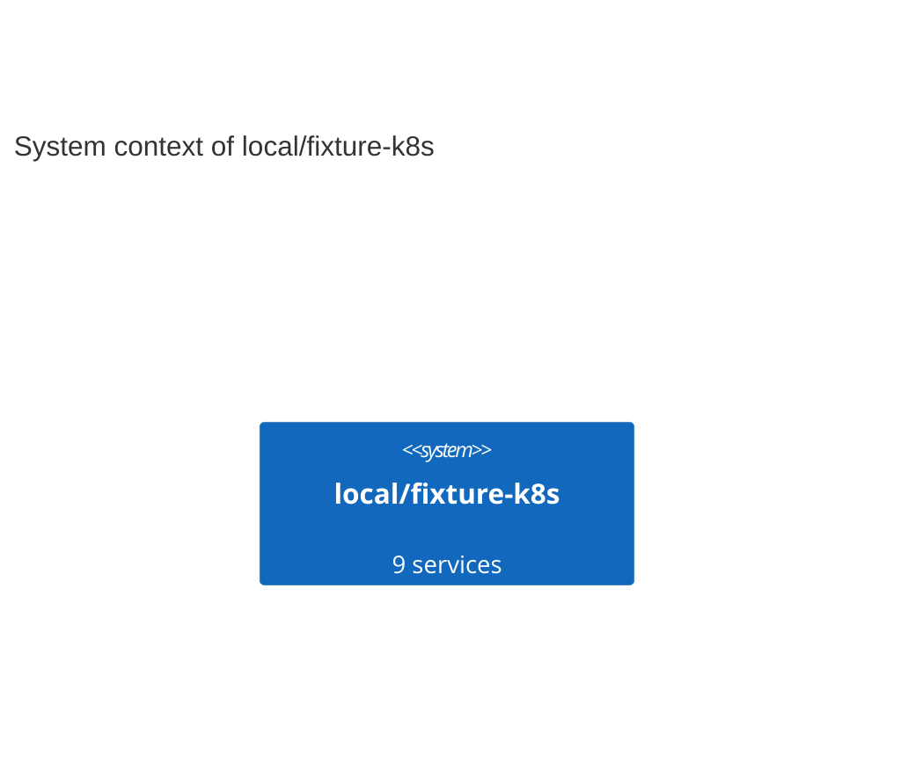
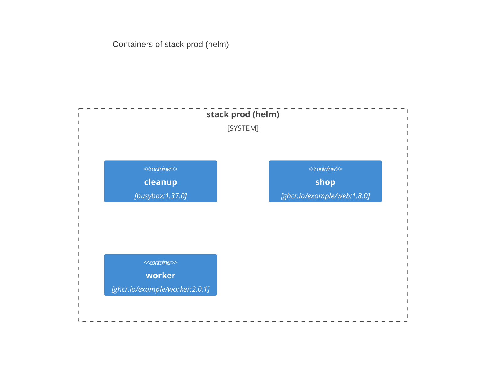
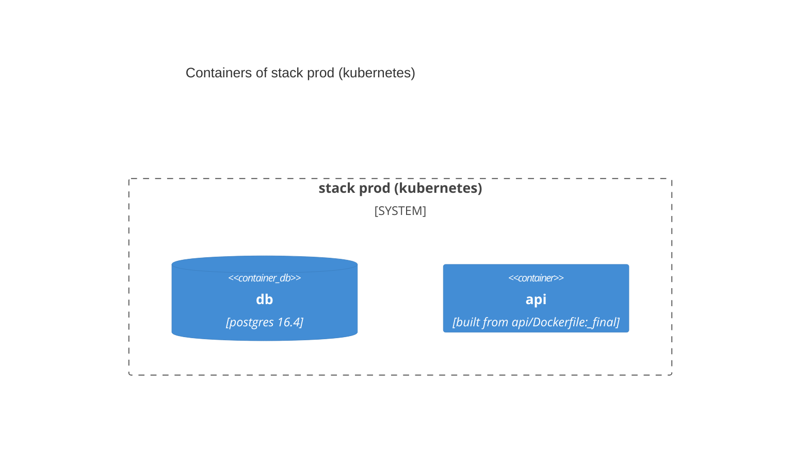

# Architecture of local/fixture-k8s

Generated by cernly test from commit `0123456` of 2026-10-14T16:02:11Z; rules 0.17.2, catalogue 2026.11.2, default branch `main`. Everything below is read from the repository's tracked files, without building or running it. Each statement has a footnote with the facts behind it and the file and line of each. Sections the code cannot answer are left for a person to write.

**Surface in production:** 0 outside parties, 1 data store, 0 columns to check, 6 unpinned images, 2 production stacks, 0 routes. Size, for context: 8 lines in 2 files (go 8), of which 5 test lines.

## 1. Introduction and goals

_Not in the code: What the system is for, and its most important quality goals._

## 2. Constraints

_Not in the code: Technical and organisational constraints._

## 3. Context and scope

No outside party is named in the code, configuration or images.

## 4. Solution strategy

_Not in the code: The fundamental decisions that shape the architecture._

## 5. Building block view

### Stack prod (helm) (production)

| Container | Kind | Code | Size | Evidence |
|---|---|---|---|---|
| cleanup | service | third-party image busybox |  | [^1] |
| shop | service | third-party image web |  | [^2] |
| worker | service | third-party image worker |  | [^3] |

### Stack prod (kubernetes) (production)

| Container | Kind | Code | Size | Evidence |
|---|---|---|---|---|
| db | data store, postgres |  |  | [^4] |
| api | service | api | 8 lines (go 8), of which 5 test lines | [^5] |

## 6. Runtime view

_Not in the code: How the building blocks work together in the most important scenarios._

## 7. Deployment view

Production is a stack a CI job on the default branch (`main`) starts, or one a person declared or confirmed.

| Stack | Role | Why | Evidence |
|---|---|---|---|
| prod (helm) | production | .github/workflows/deploy.yml job deploy: push on main | [^6] |
| shop | none | .github/workflows/lint.yml job render: renders only, does not deploy | [^7] |
| manifests | none | no CI job starts it | [^8] |
| prod (kubernetes) | production | .github/workflows/deploy.yml job deploy: push on main | [^9] |
| staging | none | .github/workflows/lint.yml job render: renders only, does not deploy | [^10] |

## 8. Crosscutting concepts

### Data

| Data store | Engine | Stack | Evidence |
|---|---|---|---|
| db | postgres 16.4 | prod | [^4] |
| staging-db | postgres 16.4 | staging | [^11] |

## 9. Architecture decisions

_Not in the code: Decisions and why they were taken._

## 10. Quality requirements

_Not in the code: Quality scenarios._

## 11. Risks and technical debt

### image_pinning (11)

- db (stack prod): image postgres:16.4 is not pinned by digest [^4]
- staging-db (stack staging): image postgres:16.4 is not pinned by digest [^11]
- api/Dockerfile, final stage: stage _final uses gcr.io/distroless/static:nonroot is not pinned by digest [^12]
- api/Dockerfile, stage build: stage build uses golang:1.24 is not pinned by digest [^13]
- cleanup (stack prod): image busybox:1.37.0 is not pinned by digest [^1]
- shop (stack prod): image ghcr.io/example/web:1.8.0 is not pinned by digest [^2]
- worker (stack prod): image ghcr.io/example/worker:2.0.1 is not pinned by digest [^3]
- cleanup (stack shop): image busybox:1.37.0 is not pinned by digest [^14]
- worker (stack shop): image ghcr.io/example/worker:2.0.1 is not pinned by digest [^15]
- api (stack prod): image ghcr.io/example/api:1.8.0 is not pinned by digest [^16]
- staging-api (stack staging): image ghcr.io/example/api:latest is not pinned by digest [^17]

## 12. Glossary

_Not in the code._

## Evidence

[^1]: `service:helm:prod:cleanup`: `.github/workflows/deploy.yml:18`, `charts/shop/templates/cleanup.yaml:2`, `charts/shop/templates/cleanup.yaml:13`
[^2]: `service:helm:prod:shop`: `.github/workflows/deploy.yml:18`, `charts/shop/values-prod.yaml:2`, `charts/shop/values.yaml:2`
[^3]: `service:helm:prod:worker`: `.github/workflows/deploy.yml:18`, `charts/shop/values.yaml:7`, `charts/shop/values.yaml:8`
[^4]: `datastore:kubernetes:prod:db`: `.github/workflows/deploy.yml:17`, `deploy/k8s/base/db.yaml:2`, `deploy/k8s/base/db.yaml:17`, `deploy/k8s/base/kustomization.yaml:5`, `deploy/k8s/overlays/prod/kustomization.yaml:5`
[^5]: `image_build:api:api/Dockerfile:_`: `.github/workflows/deploy.yml:16`; `image_recipe:api/Dockerfile:_final`: `api/Dockerfile:1`, `api/Dockerfile:2`, `api/Dockerfile:3`, `api/Dockerfile:4`, `api/Dockerfile:5`; `service:kubernetes:prod:api`: `.github/workflows/deploy.yml:17`, `deploy/k8s/base/api.yaml:2`, `deploy/k8s/base/api.yaml:17`, `deploy/k8s/base/api.yaml:23`, `deploy/k8s/base/api.yaml:26`, and 3 more
[^6]: `stack:helm:prod`: `.github/workflows/deploy.yml:18`
[^7]: `stack:helm:shop`: `.github/workflows/lint.yml:10`
[^8]: `stack:kubernetes:manifests`: `manifests/migrate.yaml:2`
[^9]: `stack:kubernetes:prod`: `.github/workflows/deploy.yml:17`
[^10]: `stack:kubernetes:staging`: `.github/workflows/lint.yml:11`
[^11]: `datastore:kubernetes:staging:staging-db`: `.github/workflows/lint.yml:11`, `deploy/k8s/base/db.yaml:2`, `deploy/k8s/base/db.yaml:17`, `deploy/k8s/base/kustomization.yaml:5`, `deploy/k8s/overlays/staging/kustomization.yaml:6`
[^12]: `image_recipe:api/Dockerfile:_final`: `api/Dockerfile:1`, `api/Dockerfile:2`, `api/Dockerfile:3`, `api/Dockerfile:4`, `api/Dockerfile:5`
[^13]: `image_recipe:api/Dockerfile:build`: `api/Dockerfile:1`, `api/Dockerfile:2`, `api/Dockerfile:3`
[^14]: `service:helm:shop:cleanup`: `.github/workflows/lint.yml:10`, `charts/shop/templates/cleanup.yaml:2`, `charts/shop/templates/cleanup.yaml:13`
[^15]: `service:helm:shop:worker`: `.github/workflows/lint.yml:10`, `charts/shop/values.yaml:7`, `charts/shop/values.yaml:8`
[^16]: `service:kubernetes:prod:api`: `.github/workflows/deploy.yml:17`, `deploy/k8s/base/api.yaml:2`, `deploy/k8s/base/api.yaml:17`, `deploy/k8s/base/api.yaml:23`, `deploy/k8s/base/api.yaml:26`, and 3 more
[^17]: `service:kubernetes:staging:staging-api`: `.github/workflows/lint.yml:11`, `deploy/k8s/base/api.yaml:2`, `deploy/k8s/base/api.yaml:17`, `deploy/k8s/base/api.yaml:23`, `deploy/k8s/base/api.yaml:26`, and 2 more
