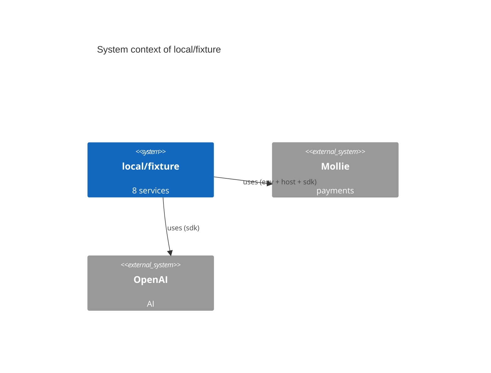
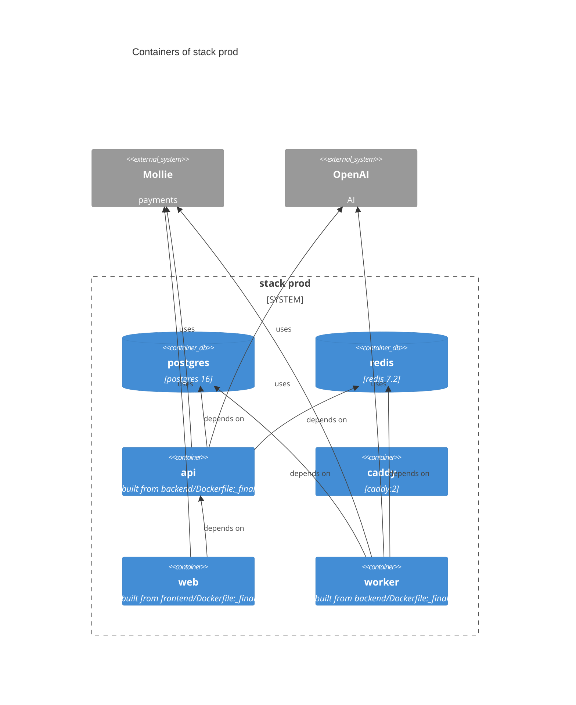
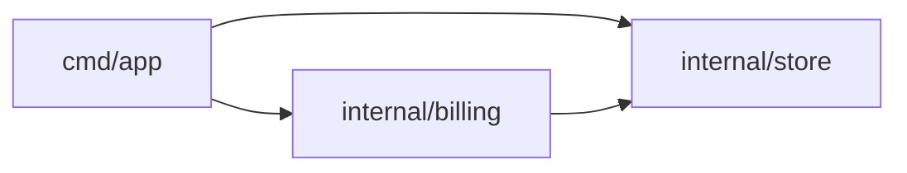

# Architecture of local/fixture

Generated by cernly test from commit `0123456` of 2026-10-14T16:02:11Z; rules 0.17.2, catalogue 2026.11.2, default branch `main`. Everything below is read from the repository's tracked files, without building or running it. Each statement has a footnote with the facts behind it and the file and line of each. Sections the code cannot answer are left for a person to write.

**Surface in all stacks:** 2 outside parties, 4 data stores, 0 columns to check, 10 unpinned images, 0 production stacks, 0 routes. Size, for context: 35 lines in 4 files (go 35), of which 9 test lines.

## 1. Introduction and goals

_Not in the code: What the system is for, and its most important quality goals._

## 2. Constraints

_Not in the code: Technical and organisational constraints._

## 3. Context and scope

Outside parties, as the provider catalogue (2026.11.2) recognises them:

| Party | Category | Seen by | Services | Evidence |
|---|---|---|---|---|
| Mollie | payments | env + host + sdk | api (stack default), web (stack default), worker (stack default), api (stack prod), web (stack prod), worker (stack prod) | [^1] |
| OpenAI | AI | sdk | api (stack default), worker (stack default), api (stack prod), worker (stack prod) | [^2] |

## 4. Solution strategy

_Not in the code: The fundamental decisions that shape the architecture._

## 5. Building block view

### Stack default (none)

| Container | Kind | Code | Size | Evidence |
|---|---|---|---|---|
| postgres | data store, postgres |  |  | [^3] |
| redis | data store, redis |  |  | [^4] |
| api | service | backend | 35 lines (go 35), of which 9 test lines | [^5] |
| caddy | service | third-party image caddy |  | [^6] |
| web | service | frontend/package-lock.json, frontend/package.json, frontend/src |  | [^7] |
| worker | service | backend | 35 lines (go 35), of which 9 test lines | [^8] |

### Stack prod (none)

| Container | Kind | Code | Size | Evidence |
|---|---|---|---|---|
| postgres | data store, postgres |  |  | [^9] |
| redis | data store, redis |  |  | [^10] |
| api | service | backend | 35 lines (go 35), of which 9 test lines | [^11] |
| caddy | service | third-party image caddy |  | [^12] |
| web | service | frontend/package-lock.json, frontend/package.json, frontend/src |  | [^13] |
| worker | service | backend | 35 lines (go 35), of which 9 test lines | [^14] |

### Module graphs

The repo's own packages each service reaches, and the imports between them. Read from the import declarations; Go only for now.

**api (stack default), worker (stack default), api (stack prod), worker (stack prod)**: 3 packages, 3 imports; every package in its sources [^15]

| Package | Imported by | Imports | Depth |
|---|---|---|---|
| `example.com/backend/cmd/app` | 0 | 2 | 2 |
| `example.com/backend/internal/billing` | 1 | 1 | 1 |
| `example.com/backend/internal/store` | 2 | 0 | 0 |

## 6. Runtime view

_Not in the code: How the building blocks work together in the most important scenarios._

## 7. Deployment view

Production is a stack a CI job on the default branch (`main`) starts, or one a person declared or confirmed.

| Stack | Role | Why | Evidence |
|---|---|---|---|
| default | none | no CI job starts it | [^16] |
| prod | none | no CI job starts it | [^17] |

## 8. Crosscutting concepts

### Data

| Data store | Engine | Stack | Evidence |
|---|---|---|---|
| postgres | postgres 16 | default | [^3] |
| redis | redis 7.2 | default | [^4] |
| postgres | postgres 16 | prod | [^9] |
| redis | redis 7.2 | prod | [^10] |

## 9. Architecture decisions

_Not in the code: Decisions and why they were taken._

## 10. Quality requirements

_Not in the code: Quality scenarios._

## 11. Risks and technical debt

### image_pinning (10)

- postgres (stack default): image docker.io/library/postgres:16-alpine is not pinned by digest [^3]
- redis (stack default): image redis:7.2-alpine is not pinned by digest [^4]
- postgres (stack prod): image postgres:16 is not pinned by digest [^9]
- redis (stack prod): image redis:7.2-alpine is not pinned by digest [^10]
- backend/Dockerfile, final stage: stage _final uses alpine:3.21 is not pinned by digest [^18]
- backend/Dockerfile, stage builder: stage builder uses golang:1.27.3-alpine is not pinned by digest [^19]
- frontend/Dockerfile, final stage: stage _final uses node:26.12.1-alpine is not pinned by digest [^20]
- caddy (stack default): image caddy:2 is not pinned by digest [^6]
- api (stack prod): image ghcr.io/example/api:1.4.0 is not pinned by digest [^21]
- caddy (stack prod): image caddy:2 is not pinned by digest [^12]

### party_unconfirmed (1)

- party:openai: OpenAI rests on one kind of signal (sdk); confirm once [^2]

## 12. Glossary

_Not in the code._

## Evidence

[^1]: `dependency:npm:frontend:@mollie/api-client`: `frontend/package.json:10`; `env_var:MOLLIE_API_URL`: `.env.example:3`, `backend/cmd/app/main.go:12`
[^2]: `dependency:go:backend:github.com/sashabaranov/go-openai`: `backend/go.mod:8`
[^3]: `datastore:compose:default:postgres`: `docker-compose.yml:20`
[^4]: `datastore:compose:default:redis`: `docker-compose.yml:22`
[^5]: `image_recipe:backend/Dockerfile:_final`: `backend/Dockerfile:1`, `backend/Dockerfile:3`, `backend/Dockerfile:4`, `backend/Dockerfile:6`, `backend/Dockerfile:7`; `service:compose:default:api`: `docker-compose.yml:10`
[^6]: `service:compose:default:caddy`: `docker-compose.yml:24`
[^7]: `image_recipe:frontend/Dockerfile:_final`: `frontend/Dockerfile:1`, `frontend/Dockerfile:3`, `frontend/Dockerfile:5`; `service:compose:default:web`: `docker-compose.yml:7`
[^8]: `image_recipe:backend/Dockerfile:_final`: `backend/Dockerfile:1`, `backend/Dockerfile:3`, `backend/Dockerfile:4`, `backend/Dockerfile:6`, `backend/Dockerfile:7`; `service:compose:default:worker`: `docker-compose.yml:17`
[^9]: `datastore:compose:prod:postgres`: `docker-compose.prod.yml:4`, `docker-compose.yml:20`
[^10]: `datastore:compose:prod:redis`: `docker-compose.yml:22`
[^11]: `image_recipe:backend/Dockerfile:_final`: `backend/Dockerfile:1`, `backend/Dockerfile:3`, `backend/Dockerfile:4`, `backend/Dockerfile:6`, `backend/Dockerfile:7`; `service:compose:prod:api`: `docker-compose.prod.yml:2`, `docker-compose.yml:10`
[^12]: `service:compose:prod:caddy`: `docker-compose.yml:24`
[^13]: `image_recipe:frontend/Dockerfile:_final`: `frontend/Dockerfile:1`, `frontend/Dockerfile:3`, `frontend/Dockerfile:5`; `service:compose:prod:web`: `docker-compose.yml:7`
[^14]: `image_recipe:backend/Dockerfile:_final`: `backend/Dockerfile:1`, `backend/Dockerfile:3`, `backend/Dockerfile:4`, `backend/Dockerfile:6`, `backend/Dockerfile:7`; `service:compose:prod:worker`: `docker-compose.yml:17`
[^15]: `import:go:example.com/backend/cmd/app:example.com/backend/internal/billing`: `backend/cmd/app/main.go:7`; `import:go:example.com/backend/cmd/app:example.com/backend/internal/store`: `backend/cmd/app/main.go:8`; `import:go:example.com/backend/internal/billing:example.com/backend/internal/store`: `backend/internal/billing/billing.go:4`
[^16]: `stack:compose:default`: `docker-compose.yml:6`
[^17]: `stack:compose:prod`: `docker-compose.prod.yml:1`, `docker-compose.yml:6`
[^18]: `image_recipe:backend/Dockerfile:_final`: `backend/Dockerfile:1`, `backend/Dockerfile:3`, `backend/Dockerfile:4`, `backend/Dockerfile:6`, `backend/Dockerfile:7`
[^19]: `image_recipe:backend/Dockerfile:builder`: `backend/Dockerfile:1`, `backend/Dockerfile:3`, `backend/Dockerfile:4`
[^20]: `image_recipe:frontend/Dockerfile:_final`: `frontend/Dockerfile:1`, `frontend/Dockerfile:3`, `frontend/Dockerfile:5`
[^21]: `service:compose:prod:api`: `docker-compose.prod.yml:2`, `docker-compose.yml:10`
